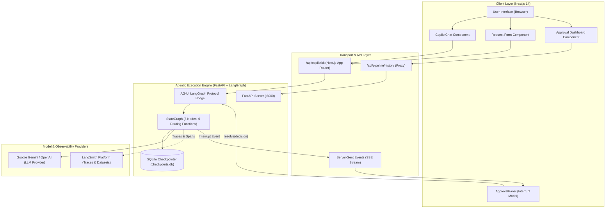
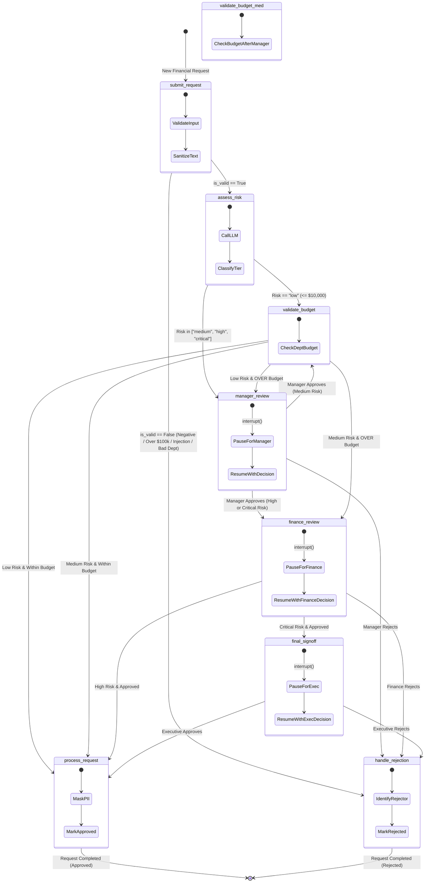

# Financial Approval System: System Architecture Documentation

**UCLA Extension — Agentic AI Course**  
**Author:** Bhavesh  

This document details the architectural layout, state machine transitions, human-in-the-loop (HITL) escalation matrix, and safety guardrails governing the Financial Approval System.

---

## 1. System Architecture & Component Interactions

The system adopts a decoupled, multi-tier agentic architecture connecting a Next.js / CopilotKit frontend to a LangGraph state graph executed inside an asynchronous FastAPI server.

### Component Breakdown
1. **Frontend Presentation**:
   - `CopilotChat`: Conversational UI providing natural language intake and workflow explanations.
   - `RequestForm`: Structured input form allowing direct parameter entry with client-side validation.
   - `ApprovalPanel`: Dynamic modal rendered via `useLangGraphInterrupt()` whenever human intervention is required.
   - `ApprovalDashboard`: Real-time analytics view providing executive KPIs, budget tracking, and pipeline execution logs.
2. **Transport & Protocol**:
   - Next.js API route (`/api/copilotkit`) proxies requests to FastAPI using CopilotKit's `LangGraphHttpAgent`.
   - Communication follows an asynchronous SSE streaming protocol supporting token streaming, tool calls, and execution interrupts.
3. **Execution & Checkpointing**:
   - FastAPI hosts the `LangGraphAGUIAgent` attached to an `AsyncSqliteSaver` checkpointer.
   - Interrupt states persist directly to disk (`checkpoints.db`), ensuring fault tolerance and zero in-memory state loss across server restarts.
4. **LLM & Observability**:
   - Powered by Gemini (`gemini-3.8-flash`) or OpenAI (`gpt-4o-mini`) via unified LangChain chat wrappers.
   - Every node execution, prompt, model completion, and interrupt resolution is traced in LangSmith under the `financial-approval-system` project.

---

## 2. State Machine Diagram & Workflow Transitions

The state machine coordinates 8 nodes and 6 conditional routers. It enforces early validation exits and escalates to human reviewers as request risk increases.

---

## 3. Human-in-the-Loop (HITL) Decision Matrix

The table below outlines when the system pauses execution for human decision-makers versus when it executes autonomously.

| Request Amount | AI Risk Level | Priority | Department Budget Status | Required Human Review Stages | Human Reviews | Automated Behavior / Path |
| :--- | :--- | :--- | :--- | :--- | :---: | :--- |
| $\le \$0$ or $> \$100\text{k}$ | *Bypassed* | Any | *Not checked* | **None** (Rejected immediately) | 0 | Auto-rejected at intake (`submit_request` $\rightarrow$ `handle_rejection`) |
| Invalid Dept | *Bypassed* | Any | *Not checked* | **None** (Rejected immediately) | 0 | Auto-rejected at intake (`submit_request` $\rightarrow$ `handle_rejection`) |
| $\le \$10,000$ | **Low** | Low / Normal | Within Budget | **None** (Auto-Approved) | 0 | `submit` $\rightarrow$ `assess_risk` $\rightarrow$ `validate_budget` $\rightarrow$ `process_request` |
| $\le \$10,000$ | **Low** | Low / Normal | **Over Budget** | **Manager Review** | 1 | `submit` $\rightarrow$ `assess_risk` $\rightarrow$ `budget` $\rightarrow$ **`manager`** $\rightarrow$ `process` |
| $\$10,001$ – $\$50,000$ | **Medium** | Low / Normal | Within Budget | **Manager Review** | 1 | `submit` $\rightarrow$ `assess_risk` $\rightarrow$ **`manager`** $\rightarrow$ `budget` $\rightarrow$ `process` |
| $\$10,001$ – $\$50,000$ | **Medium** | Low / Normal | **Over Budget** | **Manager + Finance** | 2 | `submit` $\rightarrow$ `assess` $\rightarrow$ **`manager`** $\rightarrow$ `budget` $\rightarrow$ **`finance`** $\rightarrow$ `process` |
| $\$50,001$ – $\$100,000$ | **High** | Low / Normal | Any | **Manager + Finance** | 2 | `submit` $\rightarrow$ `assess` $\rightarrow$ **`manager`** $\rightarrow$ **`finance`** $\rightarrow$ `process` |
| $> \$50,000$ | **Critical** | **Urgent** | Any | **Manager + Finance + Executive** | 3 | `submit` $\rightarrow$ `assess` $\rightarrow$ **`manager`** $\rightarrow$ **`finance`** $\rightarrow$ **`final_signoff`** $\rightarrow$ `process` |

---

## 4. Safety Guardrail Implementation Details

The safety architecture operates on a **dual-gate defense-in-depth model**: pre-execution input validation and post-execution output filtering.

### A. Input Validation Gates (`input_validator.py`)
1. **Mathematical Boundary Gate**:
   - `amount <= 0`: Rejects with `"Amount must be positive"`.
   - `amount > BUDGET_CEILING` ($100,000.00): Rejects with `"Amount exceeds budget ceiling of $100,000.00"`.
2. **Cost Center Whitelist Gate**:
   - Strictly enforces department membership in `['engineering', 'marketing', 'operations', 'research', 'hr']`.
   - Unrecognized departments (e.g. `'finance'`, `'executive'`, `'sales'`) are blocked.
3. **Payload Buffer Gate**:
   - Request Title: Capped at 200 characters.
   - Request Description: Capped at 2,000 characters.
   - Business Justification: Capped at 2,000 characters.
4. **Code & Prompt Injection Sanitization**:
   - Evaluates input strings against blocklist patterns using case-insensitive substring scanning:
     - SQL Injection: `drop table`, `delete from`, `insert into`, `update set`, `union select`, `' or '1'='1`, `'; --`
     - Cross-Site Scripting (XSS): `<script>`, `javascript:`, `onclick=`, `onerror=`
     - Arbitrary Code Execution: `eval(`, `__import__`, `os.system`, `subprocess`

### B. Output Redaction & Filtering (`output_filter.py`)
1. **PII Redaction**:
   - **SSN**: Pattern `\b\d{3}-\d{2}-\d{4}\b` $\rightarrow$ replaced with `***-**-XXXX`
   - **Credit Card**: Pattern `\b\d{4}[-\s]?\d{4}[-\s]?\d{4}[-\s]?\d{4}\b` $\rightarrow$ replaced with `****-****-****-XXXX`
   - **Email**: Pattern `\b[A-Za-z0-9._%+-]+@[A-Za-z0-9.-]+\.[A-Z|a-z]{2,}\b` $\rightarrow$ replaced with `[EMAIL REDACTED]`
   - **Phone**: Pattern `\b\d{3}[-.]?\d{3}[-.]?\d{4}\b` $\rightarrow$ replaced with `***-***-XXXX`
2. **Context-Preserving Financial Masking**:
   - Dollar amounts are masked to conceal large figures while keeping cents/suffixes visible for accounting audits (e.g. `$45,000.00` $\rightarrow$ `$***.00`).
   - Bank account numbers (8+ consecutive digits) mask leading digits while preserving the last 4 (e.g. `1234567890` $\rightarrow$ `******7890`).
